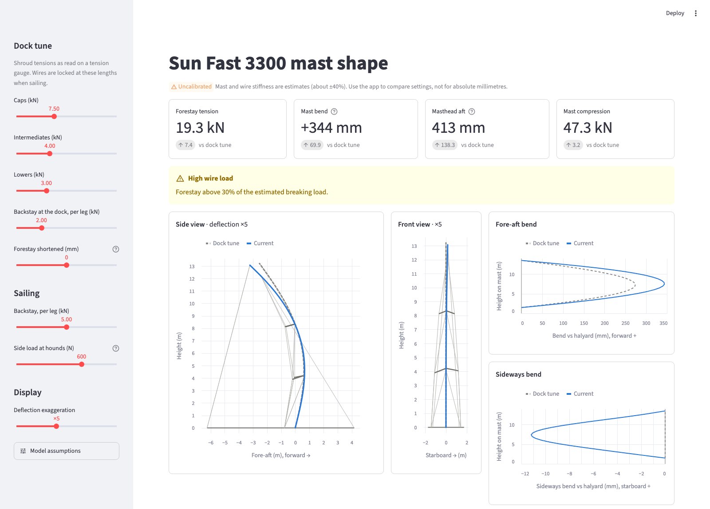

# sail-shape

Visualises how shroud and backstay tension change the mast shape of a **Jeanneau Sun Fast 3300**
(rig of *Sun Dragon*, USA 33070): fractional sloop, carbon mast, double swept spreaders,
continuous shrouds, split backstay, no runners.

A small geometrically nonlinear structural model of the rig is solved in Python, and a Streamlit
app lets you set a dock tune, adjust the backstay and see the bend.



> **Status: uncalibrated.** Mast and wire stiffnesses are first-principles estimates (about ±40%),
> and the mast-step condition is unknown. Use the app to compare settings with each other, not for
> absolute millimetres of bend. See [Calibration](#calibration).

## Quick start

```bash
python -m venv .venv
.venv/bin/pip install -e ".[app,dev]"

.venv/bin/streamlit run streamlit_app.py   # the app, http://localhost:8501
.venv/bin/python -m rigsolver               # text summary of the example tune
.venv/bin/python -m pytest                  # tests
```

## Using the app

- **Dock tune** (sidebar): shroud tensions as read on a tension gauge, the dock backstay, and
  the forestay length.
- **Sailing**: every wire is locked at its dock-tune length except the backstay, which you
  re-tension. An optional sideways pull at the hounds stands in for sail load.
- **Views**: side and front views drawn to scale with deflection exaggerated, plus bend curves
  measured from a straight halyard between gooseneck and masthead. The dock tune is shown dashed
  behind the current shape.
- **Details**: a wire table (tension, share of breaking load, rest-length change in mm and
  rigging-screw turns) and a backstay sweep (forestay tension and bend vs backstay).
- **Model assumptions**: mast-stiffness multipliers, mast-step fixity and pre-bend, for exploring
  the unknowns until the model is calibrated.

Slider settings are kept in the URL, so a link reopens the same setup.

## How it works

| Part | Model |
|---|---|
| Mast | 3D beam elements with separate fore-aft and sideways stiffness, tapering from the lower to the upper section. Moderate-rotation (von Kármán) axial strain captures the extra bend caused by compression. Self-weight matches the certificate weight and CG height. |
| Shrouds | Caps and intermediates are single continuous wires sliding over the spreader tips (one tension along the whole path). All wires are tension-only and can go slack. |
| Spreaders | Beams clamped to the mast. |
| Mast step | Pinned, with optional rotational springs (partial fixity). |
| Wire control | Each wire is set by `tension`, `rest_length`, `shorten` or `turns`. Wires set by tension get their rest length solved alongside the displacements. |
| Solver | Newton-Raphson with line search and automatic load stepping. |

Tuning follows what a crew does: wires set by tension are tuned first, then their lengths are
locked and further changes (backstay, side load) are applied.

### Inputs

| File | Contents |
|---|---|
| `docs/rig_model.json` | Rig geometry in feet, built by `docs/build_rig_model.py` from the ORR certificate, photos and assumptions. Every parameter records its source. |
| `docs/rig_properties.json` | Stiffness and strength in SI units, built by `docs/build_rig_properties.py`. Mast EI comes from the certificate section and weight; wire sizes are assumed. Also holds the calibration parameters. |
| `docs/ORR 2026 Certificate Sun Dragon.pdf`, `docs/rig-sketch.pdf`, photos | Source material for the geometry. |

To change an input, edit the parameters in the build script (or call `build(overrides)`) and
regenerate the JSON instead of editing it by hand.

## Python API

```python
from rigsolver import Rig, RigState

rig = Rig.load()
tune = rig.solve(RigState({"cap": {"tension": 7500}, "intermediate": {"tension": 4000},
                           "lower": {"tension": 3000}, "backstay": {"tension": 2000}}))
print(tune.summary())

# lock the dock tune and pull harder on the backstay
r = rig.solve(RigState({**tune.locked_controls(free=("backstay",)), "backstay": {"tension": 4000}}))
print(r.tensions["forestay"], r.chord_offset(6.5))   # N, m forward of the masthead-base chord
```

## Calibration

Nothing is calibrated yet. When dockside measurements become available:

1. Copy `measurements/TEMPLATE.json` for each measured state. Record the tune (gauge tensions)
   and what you measured: mast offsets from a taut halyard at known heights and, optionally,
   wire tensions.
2. Fit the calibration parameters (`k_EI_fa`, `k_EI_lat`, `k_EI_upper`, `k_EA_wire`,
   `base_k_rot_fa`, `base_k_rot_lat`, `prebend_m`):

   ```python
   from rigsolver import Rig
   from rigsolver.calibration import Measurement, fit, write_calibration

   meas = [Measurement.load(p) for p in ["measurements/dock-a.json", "measurements/dock-b.json"]]
   res = fit(Rig.load(), meas, ["k_EI_fa", "k_EI_lat", "base_k_rot_fa"])
   print(res.params, res.std)
   write_calibration(res, "docs/rig_properties.json")
   ```

A sideways pull on a halyard at the hounds with a known load is a good way to get the
sideways stiffness.

### Unknowns that matter most

1. Whether the mast is keel-stepped or deck-stepped, and how the step and partner hold it.
2. The rigging spec: wire type and diameters, and therefore stiffness and breaking loads.
3. Mast laminate stiffness (EI). The estimate puts the mast near its fore-aft buckling load at
   moderate tune, which is why the uncalibrated bend is large.
4. Exact spreader and chainplate positions (currently estimated from photos).

## Layout

```
rigsolver/      solver: fe.py (generic frame + sliding-cable FE), rig.py (SF3300 model),
                calibration.py (measurement format + least-squares fit)
rig_app/        app support: scenario.py (dock tune -> sailing), charts.py (Altair)
streamlit_app.py
docs/           geometry/properties builders, JSON models, source documents
measurements/   measurement template for calibration
tests/          closed-form checks, rig behaviour, calibration round trip
```
